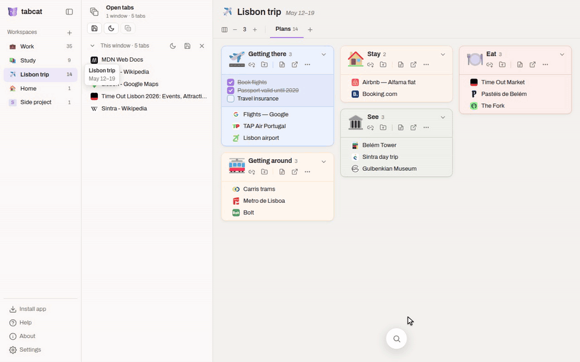
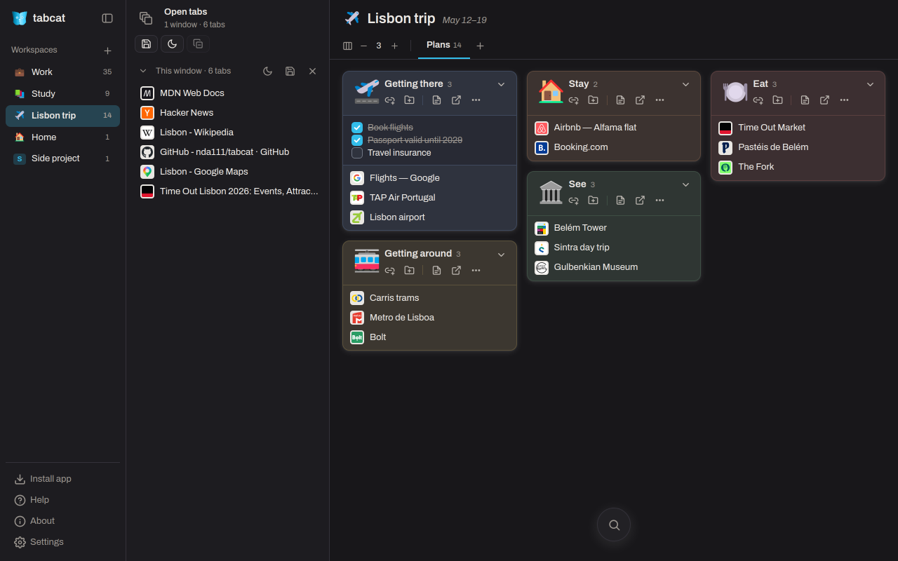
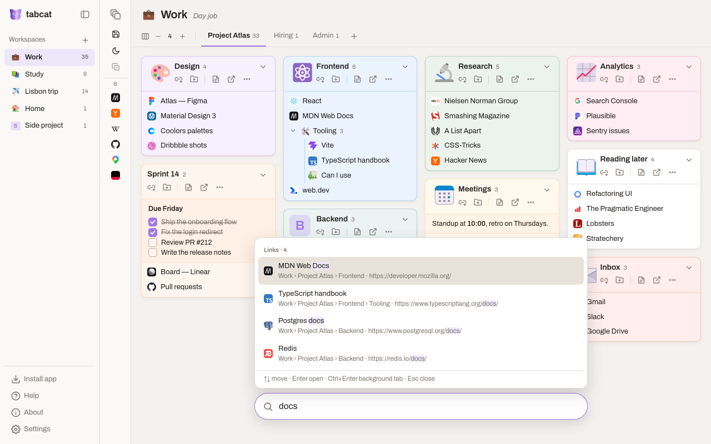
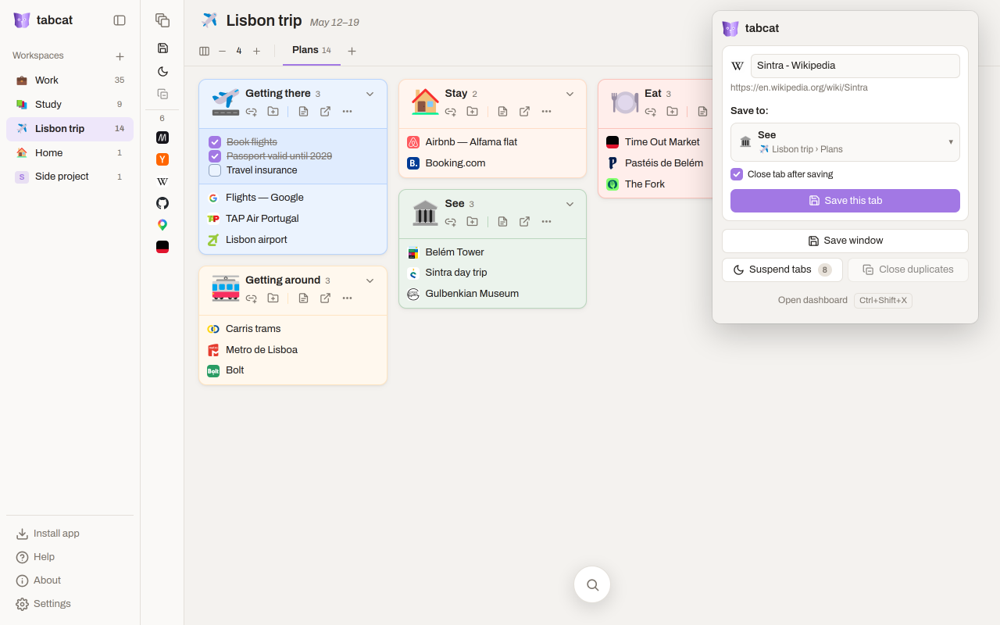

<p align="center"></p>

<h1 align="center">tabcat</h1>

<p align="center">
Save your tabs into groups and open them again whenever you need.<br>
Tabs you're not using are put to sleep to keep things light.
</p>

<p align="center">
<a href="https://chromewebstore.google.com/detail/tabcat/ojkddimicblompbmfelkfocpgmeflaib"></a>
<a href="https://github.com/nda111/tabcat/releases/latest"></a>
</p>

<p align="center">
<a href="https://chromewebstore.google.com/detail/tabcat/ojkddimicblompbmfelkfocpgmeflaib"><b>Chrome Web Store</b></a> ·
<a href="https://tabcat.ghyeok.com/"><b>Dashboard</b></a> ·
<a href="https://github.com/nda111/tabcat/issues">Report a problem</a>
</p>

<p align="center"></p>

---

Keep as many tabs open as you like. tabcat saves them as links in groups you arrange on a board,
opens them again in one click, and puts the ones you aren't using to sleep so your browser stays quick.

It works in Chromium-based browsers: Chrome, Edge, Brave, Whale and others.

## Getting started

Install tabcat from the [Chrome Web Store](https://chromewebstore.google.com/detail/tabcat/ojkddimicblompbmfelkfocpgmeflaib).
It updates itself from there.

The dashboard opens at <https://tabcat.ghyeok.com/> with a short tour. After that, press
<kbd>Ctrl</kbd>+<kbd>Shift</kbd>+<kbd>X</kbd> (<kbd>⌘</kbd>+<kbd>Shift</kbd>+<kbd>X</kbd> on macOS) to bring it up
any time, and press it again to go back to your tab.

### Installing by hand

For a browser that can't use the Chrome Web Store, or to try a release before it reaches the store:

1. Download the `.zip` from the [latest release](https://github.com/nda111/tabcat/releases/latest) and unzip it.
2. Open `chrome://extensions` (`edge://extensions` in Edge) and turn on **Developer mode**.
3. Click **Load unpacked** and pick the unzipped `tabcat` folder.

Keep the folder where it is: the browser loads tabcat from it.
When a new version is out, a dot appears on **About** in the dashboard, and About links to it.
Download the new release, replace the contents of your `tabcat` folder with it, and press **Reload** on tabcat
in `chrome://extensions`. Your groups and settings stay as they are.

A hand-installed tabcat and the store's are separate extensions with separate data.
To move over, export your data in **Settings** first, then import it into the other one.

### Hosting the dashboard locally

The dashboard is a static page, and your data stays in the extension wherever the page comes from,
so you can serve it yourself:

```sh
git clone -b pages https://github.com/nda111/tabcat.git tabcat-dashboard
cd tabcat-dashboard
python3 -m http.server 8080
```

Then open <http://localhost:8080/>. tabcat connects to a dashboard on `localhost` or `127.0.0.1` at any port,
and the shortcut and toolbar button open the dashboard you used last. To go back, open
<https://tabcat.ghyeok.com/> once. Run `git pull` to get dashboard updates.

To serve it from another address, add that address to `content_scripts` in `manifest.json` and install tabcat by hand.

## What you can do

**Save tabs.** Drag a tab from *Open tabs* onto a group, or drag a window's header to save every tab in it.
From any page, the toolbar button saves the tab to the group you pick, and
<kbd>Alt</kbd>+<kbd>Shift</kbd>+<kbd>S</kbd> / <kbd>A</kbd> saves the tab or the whole window.

**Keep them in order.** Split your work into workspaces, say work and study, and each workspace into categories.
Groups are cards on a board; they hold links and folders, up to four levels deep.
Drag anything anywhere, give groups a symbol and a colour, and write notes in Markdown with checkboxes and math.

**Open them again.** Click a link to open it, or open a whole group or folder at once, as tabs or as a tab group.

**Stay light.** Put tabs you aren't looking at to sleep, or let tabcat do it after a few idle minutes.
Close duplicate tabs in one click, and close tabs as you save them if you like.

**Find anything.** <kbd>Ctrl</kbd>+<kbd>F</kbd> searches links, folders, groups and notes.

**Change your mind.** <kbd>Ctrl</kbd>+<kbd>Z</kbd> undoes adding, editing, deleting, moving, saving and closing tabs and windows,
in every open dashboard; closed tabs come back where they were, tab groups and all.
What you delete stays in **Recently deleted** for 30 days, to put back any time.

**Make it yours.** Light and dark themes, accent colours, and 8 languages
(English, 한국어, 日本語, 简体中文, Deutsch, Español, Français, Português).
Install the dashboard as an app to give it a window of its own.

| | | |
|:-:|:-:|:-:|
|  |  |  |
| Dark theme, open tabs beside the board | Search | Save from the toolbar |

## Your data

Everything stays in your browser, kept by the extension. There's no account and no server:
the dashboard is a static page that only reads and edits what the extension holds.
You can export it to a file, and import it again, in Settings.
The full [privacy policy](https://tabcat.ghyeok.com/privacy) is on the dashboard's site.

tabcat keeps your data only in your browser, so export a backup from Settings now and then.
tabcat is provided as is, without warranty, as per the [MIT](LICENSE) License.

## Questions and problems

Found a bug or have an idea? Tell us in [Issues](https://github.com/nda111/tabcat/issues).
Every shortcut and gesture is in **Help** on the dashboard.

If you'd like to look under the hood or change tabcat, see [docs/development.md](docs/development.md).

## License

tabcat is free and open source under the [MIT License](LICENSE).
The bundled Pretendard font is under the SIL Open Font License 1.1.
