# tabcat server database

The tabcat server keeps everything it knows in one SQLite file, `tabcat.db`, in its data folder (or wherever the admin page moved it to: that path is kept in the data folder's `config.toml` as `database`). The code is in [`server/tabcat_server/db.py`](../server/tabcat_server/db.py); this page describes the database as of schema version 1.

The connection is opened with:

- `pragma foreign_keys = on`: the `references ... on delete` rules below are enforced.
- `pragma journal_mode = wal`: writes go to `tabcat.db-wal` first and are folded into the file at checkpoints.
- `pragma synchronous = normal`: a write waits for the disk only at checkpoints. The file can't be corrupted, but a power cut may undo the last few writes.

The server uses one connection for everything, behind a lock (`DB.lock`), with autocommit (`isolation_level=None`). Where several statements have to happen together, they are done while holding the lock.

What's in it:

- accounts, their sign-ins (sessions) and sign-up invitations
- the admin page's settings
- each account's synced tabcat data, and each shared workspace's
- each browser's open windows and tabs
- the mailbox (share invitations and their answers)
- the security record (events)

What isn't in it:

- **Links, groups and workspaces aren't rows.** A user's tabcat data is kept as the JSON bodies of changes (`sync_ops.body`, `share_ops.body`) and whole copies (`sync_snapshots.body`, `share_snapshots.body`) that the extension sends. The server stores them and passes them on. It reads them only to find an account's accent colour (`look` changes) and a shared workspace's name and symbol.
- Server configuration (port, data folder, the database's path, who may set up or use the admin page) lives in `config.toml` and on the command line.
- Throttling of wrong passwords, the API rate limit, and half-done two-step sign-ins are held in memory and forgotten on restart.

## Diagram

```mermaid
erDiagram
    users ||--o{ sessions : "signs in (cascade)"
    users |o--o{ invites : "created_by, used_by (set null)"
    users ||--o{ sync_ops : "changes (cascade)"
    users ||--o| sync_snapshots : "copy (cascade)"
    users ||--o{ device_tabs : "browsers (cascade)"
    users ||--o{ share_members : "member (cascade)"
    shares ||--o{ share_members : "members (cascade)"
    shares ||--o{ share_ops : "changes (cascade)"
    shares ||--o| share_snapshots : "copy (cascade)"
    users ||--o{ mail : "to_id (cascade)"
    users |o--o{ mail : "from_id (set null)"

    users {
        integer id PK
        text username UK "collate nocase"
        text password "scrypt hash"
        integer admin
        integer disabled
        text space UK "browser-side data key"
        text totp_secret
        text avatar "data: URL"
    }
    sessions {
        text token PK "sha256 of the cookie's token"
        integer user_id FK
        real expires_at
    }
    invites {
        text code PK
        integer created_by FK
        integer used_by FK
    }
    sync_ops {
        integer user_id PK,FK
        integer seq PK
        text op_id UK "unique per user"
        text body "JSON"
    }
    sync_snapshots {
        integer user_id PK,FK
        integer seq
        text body "JSON"
    }
    device_tabs {
        integer user_id PK,FK
        text device PK
        text body "JSON"
        text session "first 16 hex of the session hash"
    }
    shares {
        text id PK
        text root "workspace id"
    }
    share_members {
        text share_id PK,FK
        integer user_id PK,FK
        text role "owner, manager, editor, viewer"
    }
    share_ops {
        text share_id PK,FK
        integer seq PK
        text op_id UK "unique per share"
        integer user_id "no FK"
        text body "JSON"
    }
    share_snapshots {
        text share_id PK,FK
        integer seq
        text body "JSON"
    }
    mail {
        integer id PK
        integer to_id FK
        integer from_id FK
        text kind "invite, reply, removed, left"
        text share_id "no FK"
    }
    events {
        integer id PK
        real at
        integer user_id "no FK"
        text kind
    }
    settings {
        text key PK
        text value
    }
```

`events.user_id`, `share_ops.user_id`, `mail.share_id` and `mail.invite_id` aren't foreign keys on purpose: the record, a share's history and old mail stay after the account or share they name is gone.

All times (`*_at`, `at`, `last_seen`, `expires_at`, `deleted`, `seen`, `forgotten`) are Unix time in seconds, as `real`. Booleans are `integer` 0 or 1.

## users

One row per account.

| Column | Type | Null / default | Meaning |
|---|---|---|---|
| `id` | integer | primary key | The account's id. SQLite may hand out an id again once the newest account is deleted, so `space` (not `id`) keys an account's data in the browser. |
| `username` | text | not null, unique, `collate nocase` | What one signs in with: 2–14 letters, digits, `.`, `_`, `-`. Compared case-insensitively. |
| `password` | text | not null | `scrypt$N$r$p$<salt base64>$<key base64>` (N=2^14, r=8, p=1, 32-byte key). See `auth.py`. |
| `admin` | integer | not null, default 0 | 1: may use the admin page. There is always at least one admin who isn't suspended. |
| `disabled` | integer | not null, default 0 | 1: suspended. Can't sign in, and existing sessions stop working (`session_user` checks it, and suspending also deletes them). |
| `created_at` | real | not null | When the account was made. |
| `last_seen` | real | null | Updated on each request the account makes. |
| `space` | text | null, unique index `users_space` | The account's key for its data in the browser, sent by the extension as `X-Tabcat-Account` and checked by sync (`sync_user`). Filled by trigger `users_space_new` (24 random hex characters) whenever a row is inserted without one. Accounts from before the column existed got `cast(id as text)`. |
| `totp_secret` | text | null | Two-step sign-in's base32 secret, once turned on. Null: 2FA is off. |
| `totp_pending` | text | null | A secret shown as a QR code and not yet confirmed with a code. Moved to `totp_secret` on confirmation. |
| `totp_step` | integer | null | The last TOTP time step used (30-second counter). A code for that step or an earlier one isn't accepted again. |
| `recovery` | text | null | JSON list of sha256 hex hashes of the unused recovery codes (ten at first). A code's hash is removed when it's used. |
| `name` | text | null | A display name besides the username, up to 24 characters. Empty or null: none. |
| `avatar` | text | null | Profile photo as a `data:image/(png\|jpeg\|webp);base64,...` URL, at most 60 000 characters. Served decoded at `/api/users/<id>/avatar`. |
| `avatar_at` | real | null | When the photo was set. Used as `?v=` in the photo's URL so browsers can cache it for good. |

Columns from `space` down aren't in `SCHEMA`; `_v1` adds them with `alter table` to every file, new or old (see [Schema versions](#schema-versions-and-migrations)).

**Indexes:** the unique `username` (autoindex, nocase), `users_space` (unique, on `space`).

**Trigger:** `users_space_new`: `after insert on users when new.space is null`, sets `space = lower(hex(randomblob(12)))`.

**Rows come and go:**

- Made by `/api/setup` (the first account, an admin), `/api/signup` (when sign-up is `open`, or `invite` with a valid code), and the admin page's `/api/admin/users`.
- Changed by the account page (name, photo, password, 2FA) and the admin page (admin, suspend, reset 2FA, reset password). The CLI's `reset-password`, `make-admin` and `reset-2fa` commands also write here.
- Deleted by the account itself (`DELETE /api/me`, needs the password) or by an admin. The last admin can't be deleted. Deleting cascades to `sessions`, `sync_ops`, `sync_snapshots`, `device_tabs`, `share_members` and mail sent to the account. `invites.created_by`/`used_by` and `mail.from_id` are set to null. Then `tidy_shares` runs:
  - shares left with no members are ended (deleted, with their unanswered invites);
  - shares left with no owner get one: the highest role (manager, then editor, then viewer), the longest a member first;
  - unanswered invites whose sender is gone are deleted.

## sessions

One row per sign-in (a browser signed in to an account).

| Column | Type | Null / default | Meaning |
|---|---|---|---|
| `token` | text | primary key | sha256 hex of the random token in the cookie. The token itself is never stored, so a copy of the database can't sign anyone in. Its first 16 characters serve as the session's id in the API (`/api/me/sessions/<id>`) and in `device_tabs.session`. |
| `user_id` | integer | not null, FK `users(id)` on delete cascade | Whose. |
| `created_at` | real | not null | When it was signed in. |
| `expires_at` | real | not null | `created_at` + `session_days` days (at least 1 day when the setting is 0). Without "stay signed in": `created_at` + 1 day. |
| `agent` | text | null | The browser's User-Agent, up to 200 characters. |
| `ip` | text | null | The address it last came from (up to 64 characters). Added by `_v1`. |
| `last_seen` | real | null | When it was last used. Updated at most once a minute, or right away when the address changes. Added by `_v1`. |

**Several accounts in one browser:** the cookie `tabcat_session` holds the token of the account in use, and `tabcat_more` holds the other accounts' tokens, comma-separated. Each is a session row of its own, at most 5 per browser (`auth.MAX_ACCOUNTS`); signing in a sixth ends the oldest. `tabcat_keep` remembers whether "stay signed in" was ticked. Signing in again to an account already signed in on that browser ends its old session first.

**Rows come and go:**

- Inserted on each sign-in (`auth.new_session`).
- Deleted on sign-out, when ended from the account page, and by "sign out everywhere else" (`/api/me/logout-others`). A password change ends all of the account's other sessions; an admin's password reset or suspension ends all of them. The admin's "sign everyone out" (`/api/admin/logout-all`) ends every session but the admin's own.
- Expired rows stop working at once (each lookup checks `expires_at`) but are only deleted by `purge_sessions`, which runs when the server starts and on each sign-in.

**Indexes:** only the primary key.

## invites

Sign-up invitations made on the admin page. They are used when sign-up is set to `invite`. Not to be confused with share invites, which are `mail` rows.

| Column | Type | Null / default | Meaning |
|---|---|---|---|
| `code` | text | primary key | Random URL-safe code (`secrets.token_urlsafe(12)`), put in the sign-up link. |
| `created_by` | integer | null, FK `users(id)` on delete set null | The admin who made it. |
| `created_at` | real | not null | |
| `expires_at` | real | null | Null: never expires. Otherwise `created_at` + the days asked for. |
| `used_by` | integer | null, FK `users(id)` on delete set null | The account that signed up with it. Null: unused. |
| `used_at` | real | null | |

An invite is valid while `used_by is null` and it hasn't expired; each one can be used once. Rows are deleted only by an admin (`DELETE /api/admin/invites/<code>`); used and expired ones are kept and listed until then.

## settings

The admin page's settings, as key/value text. A missing key means its default (`DB.setting` falls back to `DEFAULTS`), so a new database has no rows. `DB.set_setting` upserts. Only `PUT /api/admin/settings` writes here, and only these keys:

| Key | Default | Values | Meaning |
|---|---|---|---|
| `signup` | `closed` | `closed`, `invite`, `open` | Who may make an account: no one (admins add them), those with an invitation, anyone. |
| `session_days` | `30` | 0–365 | How long a sign-in lasts. 0: "stay signed in" isn't offered; cookies last as long as the browser is open, and sessions end after a day on the server. |
| `login_tries` | `5` | 3–50 | Wrong passwords (or 2FA codes) from one address before it has to wait. |
| `login_lock_minutes` | `10` | 1–1440 | How long that wait is. |
| `dashboard_auto` | `1` | `1`, `0` | When the dashboard comes from GitHub: update it by itself once a day (`updates.keep_up`). |
| `log_days` | `90` | 7–365 | How long the security record (`events`) is kept. |

Values are stored as text (`str(value)`); the numbers are read back with `int()`.

## sync_ops

Each account's synced tabcat data, as its changes in the order they came. Together with `sync_snapshots`, this is how an account's groups, Recently deleted, look and settings stay the same in every browser signed in to it.

| Column | Type | Null / default | Meaning |
|---|---|---|---|
| `user_id` | integer | not null, FK `users(id)` on delete cascade | Whose. |
| `seq` | integer | not null | The change's number, per account: 1, 2, 3, ... in the order the server took them. |
| `op_id` | text | not null | The change's id, given by the browser (up to 64 characters). |
| `device` | text | null | The browser it came from (its own id, up to 64 characters). |
| `at` | real | not null | When the server took it. |
| `body` | text | not null | The change as the extension sent it, compact JSON (a batch of operations, `{"ops": [...]}`). |

**Keys:** primary key `(user_id, seq)`; unique `(user_id, op_id)`.

**How it works:**

- **Pushing** (`POST /api/sync/ops`): a browser sends changes with ids. Under the lock, each new one gets the next number after the account's head. The head is the larger of `max(seq)` here and the snapshot's `seq`, so numbering carries on after old changes are deleted. A change whose `op_id` is already kept isn't stored again; its old number is returned, so a retry after a lost answer is applied once. At most 2000 changes per request.
- **Pulling**: `GET /api/sync/state` returns the snapshot and every change after it. `GET /api/sync/ops?after=N` returns up to 1000 changes after N, with `more` when there are more. A browser that is behind the snapshot and further back than the oldest kept change gets `reload` and starts again from the snapshot.
- **Kept**: when a snapshot at `seq` S is stored, changes with `seq <= S - 5000` (`SYNC_KEEP_OPS`) are deleted. So everything after the snapshot is kept, plus up to 5000 changes before it for browsers a little behind. Nothing else deletes them except deleting the account.

The server never applies changes; the extension does, in `seq` order, the same way in every browser.

## sync_snapshots

One whole copy of each account's data, which the older changes fold into.

| Column | Type | Null / default | Meaning |
|---|---|---|---|
| `user_id` | integer | primary key, FK `users(id)` on delete cascade | Whose. At most one row per account. |
| `seq` | integer | not null | The change number this copy is as of (0: the browser's own data to start from, sent with `first` when the account had nothing yet). |
| `at` | real | not null | When it was stored. |
| `body` | text | not null | The whole data as JSON (an object; its `look.accent` is read for the account's colour). |

Written by `PUT /api/sync/snapshot` (upsert). It's refused if `seq` is beyond the head or older than the copy kept. A `first` copy is refused once there is any data. Up to 8 MB per request (`MAX_SYNC_BODY`), gzip allowed.

## device_tabs

Each of an account's browsers: the windows and tabs it has open, as it last said. Shown in the dashboard's open tabs panel of the account's other browsers. Only the latest state is kept, nothing from before.

| Column | Type | Null / default | Meaning |
|---|---|---|---|
| `user_id` | integer | not null, FK `users(id)` on delete cascade | Whose. |
| `device` | text | not null | The browser's own id for itself, as sync gives it (up to 64 characters). |
| `name` | text | not null, default `''` | What it calls itself ("Chrome on Windows"), up to 60 characters. |
| `at` | real | not null | When it last sent its tabs. |
| `body` | text | not null | JSON `{"windows": [{focused, tabs: [{url, title, icon, pinned, active, group}], groups: [{id, title, color}]}]}`, cleaned and capped by `clean_tabs` (50 windows, 500 tabs, 100 groups each). `{"windows":[]}` once the browser is signed out. |
| `label` | text | not null, default `''` | A name the user gave it, shown instead of `name` (up to 30 characters). Added by `_v1` for older files. |
| `forgotten` | real | null | When it was hidden from the panel. Null: shown. Cleared by hand, or by itself when the browser sends tabs from a sign-in made after it was hidden. Added by `_v1` for older files. |
| `position` | integer | null | Its place in the list as the user ordered it. Null: after those, in the order they came (`rowid`). Added by `_v1` for older files. |
| `session` | text | null | The first 16 characters of the session hash it last sent from (see `sessions.token`): the list shows it only while that session is alive, and can end it. Null once signed out. Added by `_v1` for older files. |

**Keys:** primary key `(user_id, device)`.

**Rows come and go:**

- Upserted by `PUT /api/sync/tabs`. On the same call, the same browser's rows under other accounts (one of this browser's own sessions, or a session that has ended) get `session = null` and empty windows. The row and its label stay for when that account signs in there again.
- Signing out or switching accounts does the same to the row the session sent.
- Changed by `PUT /api/sync/tabs/order`, `/<device>/name` and `/<device>/hidden`.
- Rows not heard from for 30 days (`DEVICE_TABS_DAYS`) are deleted, each time `GET /api/sync/tabs` is asked.

## shares

Workspaces shared between accounts. Each is data of its own (not in any account's data), kept in step like an account's, through `share_ops` and `share_snapshots`.

| Column | Type | Null / default | Meaning |
|---|---|---|---|
| `id` | text | primary key | Random, 24 hex characters (`secrets.token_hex(12)`). |
| `root` | text | not null | The workspace's id, the same in each member's data. |
| `created_at` | real | not null | |
| `name` | text | not null, default `''` | The workspace's name as last changed (up to 100 characters), for mail about it. Added by `_v1` for older files. |
| `symbol` | text | not null, default `''` | Its symbol (up to 40 characters). Added by `_v1` for older files. |

**Rows come and go:**

- Made by `POST /api/sync/shares` from one of the account's workspaces, together with the owner's `share_members` row and a snapshot at `seq` 0. Asked again for the same `root` by a member, it returns the existing share. An account may own at most 200 (`MAX_SHARES`).
- `name`/`symbol` are updated from pushed changes that `set` or `add` the root with those fields (`track_name`).
- Deleted when the owner deletes it (`DELETE /api/sync/shares/<id>`), or by `tidy_shares` when no member is left. Deleting cascades to members, ops and snapshot; the unanswered invites for it are deleted too. "Stop sharing" (`POST /api/shares/<id>/end`) keeps the row with only its owner.

## share_members

Who is in each share, and as what.

| Column | Type | Null / default | Meaning |
|---|---|---|---|
| `share_id` | text | not null, FK `shares(id)` on delete cascade | |
| `user_id` | integer | not null, FK `users(id)` on delete cascade | |
| `role` | text | not null | `owner` (exactly one), `manager`, `editor` or `viewer`. Owner, manager and editor may change the workspace. A manager may also change others' roles (not the owner's, and never to owner). The owner invites, removes, hands ownership on (becoming a manager), or ends the share. Viewers only see it. |
| `at` | real | not null | When they joined. Used to order lists and to pick the heir when the owner's account goes. |

**Keys:** primary key `(share_id, user_id)`. **Index:** `share_members_user` on `user_id`.

**Rows come and go:** inserted for the owner when the share is made, and for an invitee who accepts (as the invite's `role`, `viewer` if none). Deleted when someone leaves or is removed, when the share is ended or stopped, and by cascade. Role changes, ownership handovers and removals are checked and done under the lock as one, so a share never has two owners or none.

## share_ops

A shared workspace's changes, numbered and handed on as `sync_ops` are for an account.

| Column | Type | Null / default | Meaning |
|---|---|---|---|
| `share_id` | text | not null, FK `shares(id)` on delete cascade | |
| `seq` | integer | not null | Per share: 1, 2, 3, ... |
| `op_id` | text | not null | The change's id from the browser. |
| `user_id` | integer | null, no FK | The account that made it. Kept after the account goes. |
| `device` | text | null | The browser it came from. |
| `at` | real | not null | When the server took it. |
| `body` | text | not null | The change as JSON. |

**Keys:** primary key `(share_id, seq)`; unique `(share_id, op_id)`.

Pushed by owners, managers and editors (`POST /api/sync/shares/<id>/ops`; viewers get 403). Numbering, "applied once" by `op_id`, pulling (`/state`, `/ops?after=N`, `reload`) and pruning (`seq <= S - 5000` when a snapshot at S is stored) are the same as for `sync_ops`.

## share_snapshots

One whole copy per share.

| Column | Type | Null / default | Meaning |
|---|---|---|---|
| `share_id` | text | primary key, FK `shares(id)` on delete cascade | |
| `seq` | integer | not null | The change number it is as of (0 when the share is made). |
| `at` | real | not null | |
| `body` | text | not null | JSON `{"workspaces": [<the one shared workspace>]}`. Its single workspace's `id` must be the share's `root`. |

Written when the share is made and by `PUT /api/sync/shares/<id>/snapshot` (owners, managers, editors), with the same checks as `sync_snapshots`.

## mail

Each account's mailbox: invitations to join a share, the answers to them, and notices about shares.

| Column | Type | Null / default | Meaning |
|---|---|---|---|
| `id` | integer | primary key | |
| `to_id` | integer | not null, FK `users(id)` on delete cascade | Whose mailbox. |
| `from_id` | integer | null, FK `users(id)` on delete set null | Who sent it. |
| `from_name` | text | not null, default `''` | The sender's username at the time, shown once their account is gone. |
| `kind` | text | not null | `invite`: asked to join a share. `reply`: the answer to an invite this account sent. `removed`: let go from a share by its owner (also when the share is ended or stopped). `left`: someone left a share this account owns. |
| `share_id` | text | null, no FK | The share it's about. Kept after the share goes. |
| `ws_name` | text | not null, default `''` | The workspace's name when the mail was sent (from `shares.name`). |
| `ws_symbol` | text | not null, default `''` | Its symbol. |
| `role` | text | null | `invite` and `reply`: the role offered (`manager`, `editor`, `viewer`). |
| `answer` | text | null | `invite`: null until answered, then `accepted` or `declined`. `reply`: which. |
| `invite_id` | integer | null, no FK | `reply`: the `mail.id` of the invite it answers. |
| `at` | real | not null | When it was sent. |
| `answered_at` | real | null | `invite`: when it was answered. `reply`: the same time as `at`. |
| `deleted` | real | null | When its owner put it away. Null: in the mailbox. Can be restored until purged. |
| `seen` | real | null | When its owner first had the Mailbox open with it in it. Null: unread (counts toward the badge). Added by `_v1` for older files. |

**Indexes:** `mail_to (to_id, at)` for a mailbox, `mail_share (share_id, kind)` for a share's invites, `mail_from (from_id, kind)` for counting an account's waiting invites.

**Rows come and go:**

- An owner's invite inserts an `invite`. There is at most one unanswered invite per share and person, and at most 50 unanswered invites per sender (`MAX_INVITES_WAITING`).
- Answering sets `answer` and `answered_at`, and inserts a `reply` to the sender if they still exist.
- `removed` and `left` are inserted by `tell`.
- An owner taking an invite back, ending or stopping the share, and the sender's account being deleted all delete the unanswered invites (`answer is null`).
- `POST /api/mail/delete` sets `deleted`; an invite only once it's answered. `POST /api/mail/restore` clears it.
- Mail put away more than 30 days ago (`MAIL_KEEP_DAYS`) is deleted each time a mailbox is opened (`GET /api/mail`). Mail not put away is kept until its recipient's account goes.
- A mailbox shows the newest 500.

## events

The security record: sign-ins, account changes and admins' actions. It never holds tabcat data (links, groups).

| Column | Type | Null / default | Meaning |
|---|---|---|---|
| `id` | integer | primary key | Also the order for paging (`order by id desc`, `before=<id>`). |
| `at` | real | not null | |
| `user_id` | integer | null, no FK | The account it's about. Kept after the account goes. |
| `username` | text | null | That account's username at the time. |
| `kind` | text | not null | What happened (see below). |
| `ip` | text | null | The client's address (through trusted proxies). |
| `agent` | text | null | User-Agent, up to 200 characters. |
| `actor` | text | null | For an admin's action: the admin's username. |
| `detail` | text | null | Extra, up to 200 characters (see below). |
| `tried` | text | null | Signing in: the username typed (up to 60 characters), which may be no account's. Added by `_v1` for older files. |

**Indexes:** `events_at (at)` for purging and the last day's failures, `events_user (user_id, at)` for an account's record.

**Kinds.** The category and result are worked out from `kind` when read (`event()` in `app.py`); they aren't stored. Result is `bad` (failed), `warn` (held off) or `ok`.

| Category | Kind | Result | Detail |
|---|---|---|---|
| signin | `login_ok` | ok | `2fa` when completed with a code |
| signin | `login_fail` | bad | `unknown` when no such account (then `user_id` is null, `tried` set) |
| signin | `login_locked` | warn | (throttled) |
| signin | `login_refused` | bad | `suspended` |
| signin | `twofa_fail` | bad | |
| signin | `recovery_used` | ok | `left:<n>` codes left |
| signin | `logout`, `logout_others` | ok | |
| signin | `session_ended` | ok | the ended session's `ip agent` |
| signin | `rate_limited` | warn | `n:<count>` held off since the last entry (at most one entry per address per minute) |
| account | `signup` | ok | `invite` when signed up with one |
| account | `password_changed`, `account_deleted`, `twofa_on`, `twofa_off`, `recovery_new` | ok | |
| account | `password_wrong` | bad | (wrong current password on the account page) |
| admin | `setup` | ok | (the first account made) |
| admin | `user_added` | ok | `admin` when made an admin |
| admin | `role_changed` | ok | `admin` or `user` |
| admin | `suspended`, `unsuspended`, `twofa_reset`, `password_reset`, `user_deleted` | ok | |
| admin | `settings_changed` | ok | `key=value, ...` of what changed |
| admin | `logout_all`, `invite_deleted` | ok | |
| admin | `invite_created` | ok | `days:<n>` when it expires |
| admin | `db_moved` | ok | the new path |
| admin | `server_updated` | ok | the release tag |
| admin | `tailscale_serve` | ok | `on` or `off` |

**Rows come and go:** inserted by `log()` in `app.py`. Rows older than `log_days` days are deleted by `purge_events`, which runs when the server starts and on each sign-in.

## Schema versions and migrations

The schema's version is SQLite's `PRAGMA user_version`. `db.SCHEMA_VERSION` is `len(MIGRATIONS)`.

| Version | Release | Step |
|---|---|---|
| 0 | | A new, empty file, or one made by a development build before the version was kept. |
| 1 | tabcat-server 1.0.0, the first release | `_v1` |

`DB.migrate()` runs each time the database is opened (by the server, and by the CLI commands before they act):

1. It reads `user_version`. If it's greater than `SCHEMA_VERSION`, it raises `TooNew` and the file isn't opened: an older server would mishandle data it doesn't know. The CLI prints the message and exits; it says to update tabcat-server or use a copy made before.
2. If it equals `SCHEMA_VERSION`, nothing is done.
3. Otherwise, unless the file is new (version 0 with no tables), it copies the file first to `<name>.v<old version>.bak` beside it (for example `tabcat.db.v0.bak`), using SQLite's backup API. An existing copy of that name is overwritten.
4. It then runs each missing step `MIGRATIONS[n]` (taking version n to n+1) in a transaction of its own (`begin immediate`), sets `user_version = n + 1` in the same transaction, and commits. If a step fails, it's rolled back and the error is raised; the file stays at the last version that completed.

**`_v1`** runs every statement of `SCHEMA` (all `create ... if not exists`; one at a time, not with `executescript`, which would commit the transaction). For a file from development, it then adds whatever columns are missing:

- `users`: `space` (filled with `cast(id as text)`), `totp_secret`, `totp_pending`, `totp_step`, `recovery`, `name`, `avatar`, `avatar_at`
- `sessions`: `ip`, `last_seen`
- `events`: `tried`
- `device_tabs`: `label`, `forgotten`, `position`, `session`
- `shares`: `name`, `symbol`
- `mail`: `seen`

Last, it creates the unique index `users_space` and the trigger `users_space_new`. The columns listed for `users` and `sessions` aren't in `SCHEMA` at all, so `_v1` adds them to every file, new ones included. The other tables' columns listed are in `SCHEMA` and are added only to files made before them.

**Adding a migration:**

- Write a function `_v2(conn)` (and so on) and append it to `MIGRATIONS`, noting the release in the comment above it. `SCHEMA_VERSION` follows.
- Never edit a released step. A released `_v1` must keep producing version 1's shape, so `SCHEMA` stays version 1's tables.
- New tables, columns, indexes and data changes go in the new step. Execute statements one by one with `conn.execute` (no `executescript`, no `commit`): `migrate` owns the transaction.
- A file from before the step is then copied to `.v1.bak` and brought up when the new server first opens it. Older servers refuse it from then on.

## Backups

- **While the server is stopped**, copy `tabcat.db`. If `tabcat.db-wal` and `tabcat.db-shm` are there, copy them along with it (or open the database once with sqlite3 to checkpoint them into the file). While the server runs, the main file alone may lack recent writes that are still in `-wal`.
- **While it runs**, the admin page's download (`GET /api/admin/backup`) makes a consistent copy with SQLite's backup API into a temporary folder, sends it as `tabcat-<date>-<time>.db`, and deletes it once sent. That copy is a single file with no `-wal`.
- **To restore**, stop the server, put the copy in place as `tabcat.db`, and remove any old `-wal`/`-shm` beside it.
- Moving the database from the admin page (`DB.move_to`) also copies it with the backup API, switches to the new file, and deletes the old file with its `-wal` and `-shm`.
- `tabcat-server reset-server` deletes the file with its `-wal` and `-shm`.
- The `.v<n>.bak` files from migrations are left in place; delete them once the upgrade is known to be fine.
